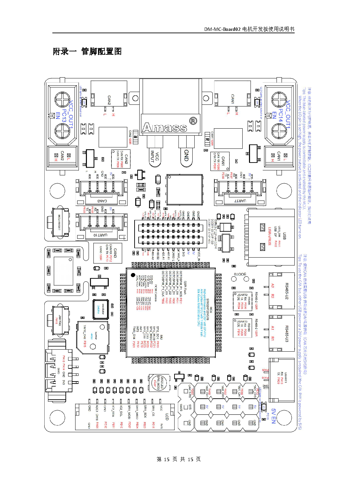
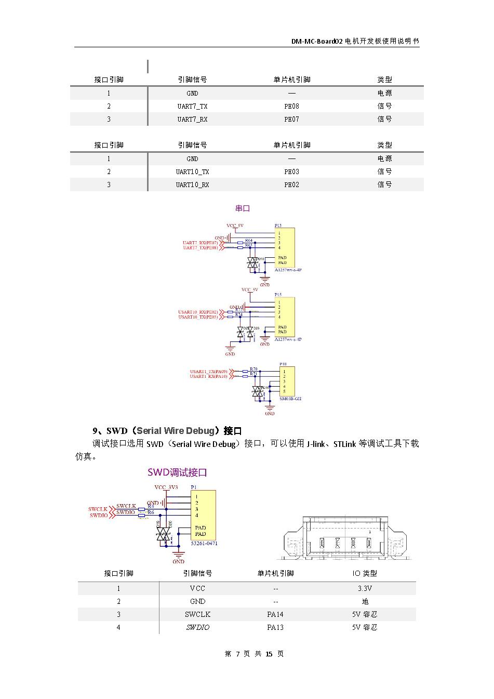
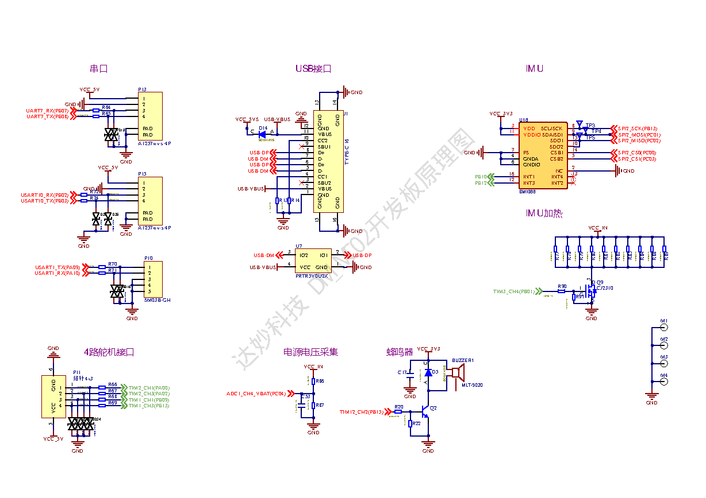

# HerKules L4 · DM-MC02 考核指南

这次作业要在 `src/wiring.rs` 配好两根 SWD GPIO 和一组 UART，烧录后验证 USB 发现、SWD 读 ID 和 UART 回环。可以先烧原始模板，确认电脑能发现板子和控制串口，再补两个 TODO。作业范围和交付以 [项目 README](../README.md) 为准。

## 1. 确认工具和编译环境

你的终端已有 `(.venv)`，且已经装好 `pyserial 3.5`。pip 升级提示可以先忽略。在工程根目录运行：

```sh
probe-rs --version
cargo build --locked
```

如果找不到 `probe-rs`，先运行 `cargo install probe-rs-tools --locked`，然后重新查版本。编译成功会出现 `Finished`，固件位于 `target/thumbv7em-none-eabihf/debug/dm-mc02-cmsis-dap`。原始模板已在本机用锁定依赖离线编译通过。新开终端跑测试脚本前，用 `source .venv/bin/activate` 激活环境。 [probe-rs 安装说明](https://probe.rs/docs/getting-started/installation/)

## 2. 找到板上的插座和脚号

`P1` 是板上的一个插座编号，`P1.2` 指这个插座的 **2 号针**。用下图顶部的大电源插座给实物定方向。按图中的朝向，**P1（SWD）在左下边缘，P11（四路 PWM 排针）在右下角，P13（UART7）在右侧 USB-C 的上方**。实物可能只印接口功能名。



| P1 脚号 | 信号 | 用途 |
| --- | --- | --- |
| 1 | 3.3 V | 电源脚 |
| 2 | GND | 地 |
| 3 | SWCLK，接 MCU 的 PA14 | SWD 时钟 |
| 4 | SWDIO，接 MCU 的 PA13 | SWD 双向数据 |

看下面官方说明书第 9 节右下角的 P1 插座正视图。**按插座卡扣、开口和 1 脚标记核对方向**。从插座正面看和从线束背面看，左右会反过来。



两张图来自 [达妙官方说明书 V1.1 第 9 节和附录一](https://github.com/dmBots/DM-MC02/blob/master/manual/%E8%BE%BE%E5%A6%99%E7%A7%91%E6%8A%80DM-MC-Board02%E7%94%B5%E6%9C%BA%E5%BC%80%E5%8F%91%E6%9D%BF%E4%BD%BF%E7%94%A8%E8%AF%B4%E6%98%8E%E4%B9%A6V1.1.pdf)。

## 3. 第一次烧录 · 用外置探针

断电时接线。电脑通过 USB 连接外置探针，也通过 USB-C 数据线连接 DM-MC02。按外置探针上标的信号名找对应引脚。

```text
电脑 ── USB ── 外置探针             DM-MC02
                   GND ────────── P1.2  GND
                 SWCLK ────────── P1.3  SWCLK
                 SWDIO ────────── P1.4  SWDIO
电脑 ── USB-C 数据线 ───────────── DM-MC02 USB-C
```

烧录期间先把 P11 到 P1 的回接线拔掉。板子由 USB-C 供电。若外置探针要求连接目标电压检测线 VTref，按该探针的说明接线，先确认探针端该脚的功能。

```sh
probe-rs list
cargo run --locked
```

第一条应看到外置探针。列表里如果也有 `DM-MC02 CMSIS-DAP Demo`，烧录时选择外置探针。第二条会编译并写入固件。确认烧录完成后按 `Ctrl+C` 退出日志会话，板上程序会继续运行。无 RTT 日志是模板的正常表现。

**可先测试原始模板。** `probe-rs list` 应列出演示探针，`python3 -m serial.tools.list_ports` 应看到板子新增的两个串口。macOS 上通常可用 `/dev/cu.usbmodem…`。用 `python3 host.py 实际端口名 ping` 试两个端口，返回 `OK DM-MC02` 的是控制口。对这个端口执行 `swd`，原始模板预期返回 `ERR SWD_NOT_CONFIGURED`。

## 4. 编写两个 TODO

下面采用同板回接，并选择 P13 的 UART7。对照原理图第 2 页左下的 **P11** 和左上的 **P13**。P11 每路都有信号、5V 和 GND，表中只使用信号脚。说明书里的 UART7 表格和同页的四针原理图有出入，本指南的 P13 脚号按四针原理图填写。 [达妙官方原理图 V1.0](https://github.com/dmBots/DM-MC02/blob/master/drawings/2d/schematics/CtrBoard-H7_V1.0-240124.pdf)



| 用途 | 代码里的 MCU 引脚 | 接插件 |
| --- | --- | --- |
| 探针侧 SWCLK | `PA0` | P11 第 1 路信号脚（TIM2_CH1） |
| 探针侧 SWDIO | `PA2` | P11 第 2 路信号脚（TIM2_CH3） |
| UART7 TX | `PE8` | P13.4 |
| UART7 RX | `PE7` | P13.3 |

### TODO 1 · 让 SWD 对象使用选定的 GPIO

1. 打开 [wiring.rs](../src/wiring.rs)，找到 `configure` 里的 `let swd = None`。
2. 从 `embassy_stm32::gpio` 导入 `Output`、`Flex`、`Level` 和 `Speed`。
3. 用 `Output::new` 包装 `p.PA0`，初始电平选 `Level::Low`，速度可用 `Speed::Low`。用 `Flex::new` 包装 `p.PA2`。SWDIO 需要在发送和接收之间切换方向。
4. 按 **时钟、数据** 的顺序传给 `Swd::new`，把结果放进 `Some(...)`。收发时序和读取 DPIDR 的逻辑已由 [swd.rs](../src/swd.rs) 提供。
5. 运行 `cargo build --locked`，先把这一部分的编译错误解决。

### TODO 2 · 配置 UART7 和收发缓冲区

1. 在文件级使用 `bind_interrupts!`，把中断 `UART7` 绑定到 `usart::BufferedInterruptHandler<peripherals::UART7>`。可以对照 [board.rs](../src/board.rs) 的中断绑定写法。
2. 使用两块独立的 `StaticCell<[u8; 128]>` 作为 TX 和 RX 缓冲区。各调用一次 `.init([0; 128])`。128 字节是本指南的示例选择，静态存储用于满足返回值的 `'static` 生命周期。
3. 用 `usart::Config::default()`。锁定的 Embassy 0.6.0 默认是 **115200 baud、8 数据位、无校验、1 停止位**。
4. 调用 `BufferedUart::new`。顺序是 **外设 → RX 引脚 → TX 引脚 → TX 缓冲区 → RX 缓冲区 → 中断绑定 → 配置**。本方案的 RX 是 `p.PE7`，TX 是 `p.PE8`。构造函数返回 `Result`，取出成功的 UART 并用 `Some(...)` 替换 `let uart = None`。
5. 再运行 `cargo build --locked`。如果报 `RxPin` 或 `TxPin` trait 不匹配，先看引脚顺序。若报中断的 `Binding` 类型不匹配，核对外设和处理器都对应 UART7，并且用了带缓冲区的处理器。

## 5. 烧录新版并接测试跳线

按第 3 步用外置探针烧录新版。烧好后按 `Ctrl+C`，断电并拔掉外置探针，然后接测试线。

**SWD 回接。** 回接指把同一块板上由代码控制的 P11 GPIO，接回板上目标芯片的 P1 调试口。两根线分别连接时钟和数据。同板内部已经共地。

```text
同一块 DM-MC02

P11 第 1 路信号脚（PA0） ──────── P1.3（SWCLK）
P11 第 2 路信号脚（PA2） ──────── P1.4（SWDIO）
```

**UART 回环。** 用一根线短接同一个 P13 插座的 TX 和 RX，电脑发来的字节就能经过物理 UART 返回。P13.1 是 5V，P13.2 是 GND，回环只连接 3 和 4 脚。

```text
P13.4（TX，PE8） ──────── P13.3（RX，PE7）
```

接好后插回 USB-C 数据线。重新列出串口，用 `ping` 确定控制口。另一个 USB 串口用于 UART 回环。

## 6. 按顺序验收

把 `CONTROL_PORT` 和 `UART_PORT` 换成实际串口名。下面是目标输出，最终提交时请记录你的实际结果。

| 命令 | 通过标准 |
| --- | --- |
| `probe-rs list` | 列出 `DM-MC02 CMSIS-DAP Demo` |
| `python3 host.py CONTROL_PORT ping` | `OK DM-MC02` |
| `python3 host.py CONTROL_PORT swd` | `OK DPIDR XXXXXXXX`，末尾是八位十六进制数 |
| 再执行一次 `python3 host.py CONTROL_PORT swd` | 读到相同的 DPIDR |
| `python3 host.py CONTROL_PORT ping` | 再次返回 `OK DM-MC02` |
| `python3 host.py UART_PORT uart-loopback` | `OK UART loopback`，脚本逐字节核对了 `HerKules UART\n` |

本作业通过 `probe-rs list` 验收 USB 演示接口的发现，通过控制串口的 `SWD ID` 验收真正的 GPIO 通信。

| 现象 | 先检查 |
| --- | --- |
| 烧录工具找不到外置探针 | 检查外置探针到电脑的 USB 线和探针是否被其他会话占用 |
| 找到外置探针但连不上板子 | 检查板子供电、P1 朝向、GND 和两根信号线 |
| USB 看不到演示探针和串口 | 检查 DM-MC02 的 USB-C 数据线、供电和烧录结果 |
| `ping` 无响应 | 换另一个 USB 串口，关闭占用端口的串口工具 |
| `ERR SWD_NOT_CONFIGURED` | 确认新版已烧录，`swd` 已经是 `Some(...)` |
| `ERR SWD` | 检查 P11 是否取到正确的信号脚、P1.3 和 P1.4 是否接反、外置探针是否拔掉 |
| 回环超时或收到的字节不对 | 检查端口、P13.3 与 P13.4 的短接、UART7 中断和收发参数顺序 |

## 7. 整理最终提交

按 [作业提交要求](../README.md#提交) 准备三项：

1. **`src/wiring.rs`**，包含你写完的两项配置。
2. **引脚表**，写清 SWCLK、SWDIO、UART TX、UART RX 的 MCU 引脚和接插件脚号。使用同板回接时，也写出两根线对应的 P1 目标脚。
3. **实测记录**，写下实际串口名、测试命令及输出、两次 DPIDR、回环结果和未测项目。CAN 是选做，没做就写未测。

实测记录还要说明一项通过实验确认的配置。可以先记录 UART 回环成功，再断电拔掉回环跳线、上电复测，最后把线接回再测一次。若实际结果是「成功、超时、再次成功」，这三次输出就能说明数据经过了所选 P13 的 TX/RX 信号脚。
